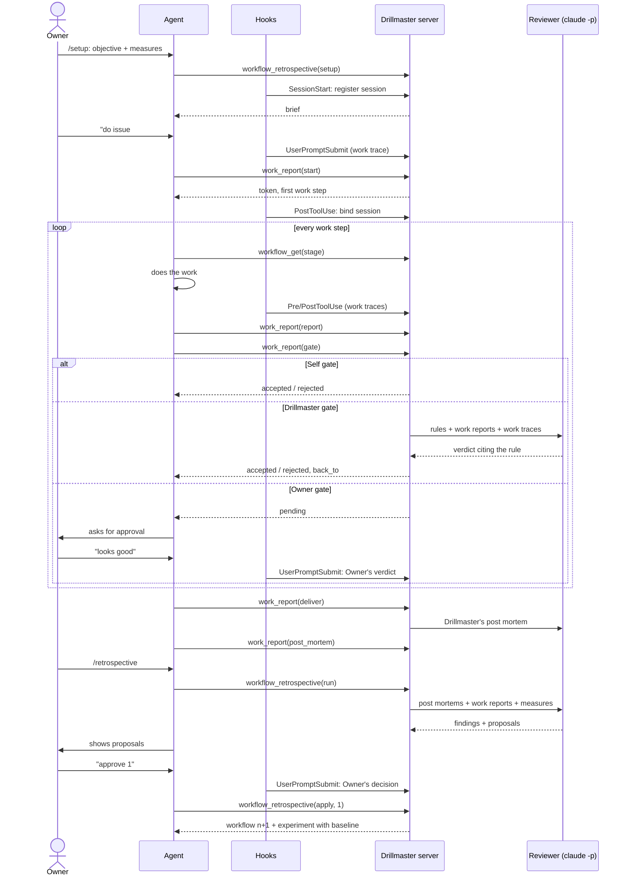

# claude-devops-drillmaster

Drillmaster is a drill sergeant trained in agile, who runs your agentic development workflow like a
bootcamp: every work item runs through your workflow step by step and gate by gate, and the work
traces and work reports feed the workflow retrospectives that keep it improving.

## Install

```
/plugin marketplace add Delkrak/claude-devops-drillmaster
/plugin install devops-drillmaster@claude-devops-drillmaster
```

## How it is used

The intended workflow, step by step. Who acts is in **bold**; the tool or hook is in `code`.

**Once, to begin**

1. **Owner** runs `/devops-drillmaster:setup`, and states the objective and its measures.
2. **Agent** calls `workflow_retrospective(setup)`, and the server creates `workflow_0`. It holds
   only the objective: no work stages, work policies or workflow experiments yet.

**Every session**

3. The `SessionStart` hook registers the session and briefs **Agent**: the workflow version, any
   active work item, and any pending gate.

**Every work item**

4. **Owner** gives Agent an issue. The `UserPromptSubmit` hook records Owner's words as a work trace.
5. **Agent** calls `work_report(start)` and gets its token and the first work step. The
   `PostToolUse` hook binds the session to the work item.
6. For each work step, in order:
   1. **Agent** reads the step with `workflow_get(stage)`: its gate, the full rules, and what to
      report.
   2. **Agent** does the work. Every tool call is recorded by the `PreToolUse` and `PostToolUse`
      hooks.
   3. **Agent** reports in real time with `work_report(report)`: impediments, better ways,
      decisions, questions and assumptions.
   4. **Agent** hands in the gate with `work_report(gate)`, with one self check per rule.
      - **Self gate:** accepted or rejected at once.
      - **Drillmaster gate:** the reviewer (`claude -p`) judges it from the rules, the work reports
        and the work traces.
      - **Owner gate:** pending. Agent asks Owner, and Owner's reply ("looks good" / "no, fix X") is
        captured by the `UserPromptSubmit` hook as the verdict.
   5. When the gate is accepted, the item moves on to the next step. When it is rejected, the item
      goes back to where the verdict says.
7. With no work stages yet (`workflow_0`), there are no gates: **Agent** does its best, and
   **Owner** corrects it. Those corrections are recorded, and the workflow grows from them.
8. **Agent** calls `work_report(deliver)` once every gate has passed. **Drillmaster** writes its
   post mortem in the background.
9. **Agent** writes its own post mortem with `work_report(post_mortem)`: what to keep, what to
   change, how the experiments did, and anything else.

**When Owner calls for it**

10. **Owner** runs `/devops-drillmaster:retrospective`.
11. **Agent** calls `workflow_retrospective(run)`. **Drillmaster** reads the post mortems, the work
    reports, Owner's corrections and the measures. It returns findings and numbered proposals,
    including verdicts on the running experiments.
12. **Owner** answers in plain words ("approve 1 and 3", "yes", "no"). The `UserPromptSubmit` hook
    records the decision.
13. **Agent** calls `workflow_retrospective(apply)` for each approved proposal. The server refuses
    any proposal Owner did not approve. Each change makes a new workflow version and opens a
    workflow experiment with its measure's baseline.



## Skills

| Skill | What it does |
|---|---|
| `/devops-drillmaster:concept` | Explains the Drillmaster concept: the philosophy, the chain of command and the workflow. |
| `/devops-drillmaster:setup` | Owner sets the objective and its measures, and Drillmaster creates `workflow_0`, which holds only that objective. |
| `/devops-drillmaster:work` | How Agent runs a work item with the drillmaster tools: start it, report, hand in each gate, deliver, then write the post mortem. |
| `/devops-drillmaster:retrospective` | Drillmaster's findings and proposals. Owner decides each proposal in their own words, and each approved one becomes a workflow experiment. |

The concept lives in [`skills/concept/SKILL.md`](skills/concept/SKILL.md). Everything else in
Drillmaster is built on it.

## The Drillmaster server

`server/` is the npm package `claude-devops-drillmaster`. It is the only thing that stores anything:

- the plugin's MCP server (`drillmaster mcp`) forwards Agent's tool calls to it;
- the hooks send their traces to its REST endpoints.

It runs as one shared local server and starts on its own the first time it's needed.

| MCP tool | What it does |
|---|---|
| `workflow_get` | Describes the workflow: the objective, the work stages and work steps, the rules, and the experiments. |
| `work_report` | Agent's only write tool, with five actions: `start`, `report`, `gate`, `deliver` and `post_mortem`. |
| `workflow_retrospective` | `setup` creates `workflow_0`. `run` returns Drillmaster's findings and proposals. `apply` applies a proposal Owner approved. |
| `work_status` | Shows where a work item is, with its work reports and work traces. |

**Measures.** v1 computes five measures from the events:
- `owner_corrections_per_item`;
- `gate_rejections_per_item`;
- `review_rounds_per_item`;
- `minutes_per_item`;
- `tool_calls_per_item`.

A workflow experiment's baseline is its measure's mean over the last 5 delivered work items.

Each work gate is judged by the level of the chain of command it belongs to:
- **Self gate:** Agent's own self check decides it at once.
- **Drillmaster gate:** a headless `claude -p` reviewer judges it. It gets the rules, the new and
  past work reports, and the work traces. It runs with no tools and no MCP, and needs no API key.
- **Owner gate:** it stays pending until Owner's own words to Agent decide it. In v1, plain
  agreement such as "looks good" approves it, and words like "no" or "fix" reject it.

The hooks (`hooks/hooks.json`) record every action and every Owner prompt as a work trace. They
cover SessionStart, UserPromptSubmit, PreToolUse, PostToolUse, Stop and SubagentStop. A project
without a workflow is never traced.

Until the package is published, build it once, then load the plugin from this folder:

```
cd server && npm install && npm run build
claude --plugin-dir <path to this repo>
```

The CLI:

```
drillmaster init --objective "<Owner's objective>" --measure owner_corrections_per_item
drillmaster inspect [--json]
```

`DRILLMASTER_HOME` sets where the server keeps its port file and store. It defaults to
`~/.drillmaster`.

## Development

```
cd server
npm test            # unit, api, mcp and hooks layers (CI)
npm run typecheck
claude plugin validate ..

npm run build && DRILLMASTER_PLUGIN_TESTS=1 npm run test:plugin   # real Claude Code, scripted reviewer
npm run sim -- test/sim/scenarios/export-features.json --owner llm # an agent plays Owner
```

The simulated-Owner harness and its scenarios are described in
[`server/test/sim/README.md`](server/test/sim/README.md).
