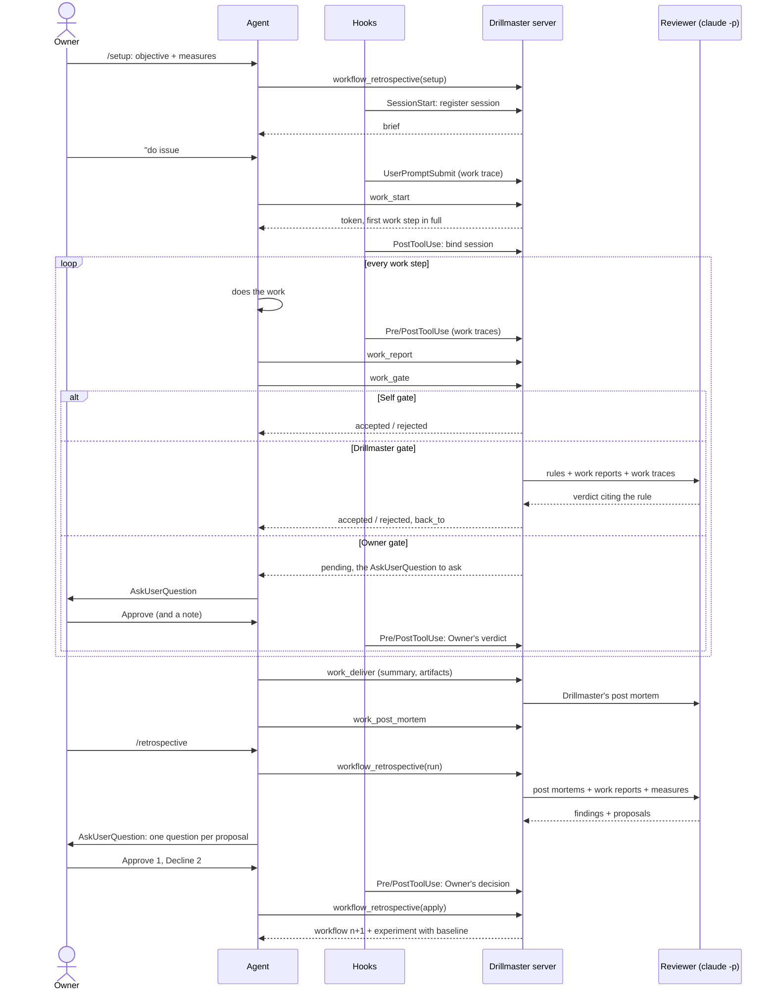

# claude-devops-drillmaster

Drillmaster is a drill sergeant trained in agile, who runs your agentic development workflow like a
bootcamp: every work item runs through your workflow step by step and gate by gate, and the work
traces and work reports feed the workflow retrospectives that keep it improving.

## Install

```
/plugin marketplace add Delkrak/claude-devops-drillmaster
/plugin install devops-drillmaster@claude-devops-drillmaster
```

## How it is used

The intended workflow, step by step. Who acts is in **bold**; the tool or hook is in `code`.

**Once, to begin**

1. **Owner** runs `/devops-drillmaster:setup`, states the objective and its measures, and names
   the Drillmaster repository: a private git repository that keeps everything of Drillmaster.
2. **Agent** calls `workflow_retrospective(setup)`, and the server creates workflow `0.0.0`. It
   holds only the objective: no work stages, work policies or workflow experiments yet. The server
   pushes the pin and the workflow to the repository's main first, then writes `.drillmaster` into
   the work folder.

**Every session**

3. The `SessionStart` hook registers the session and briefs **Agent**: the workflow version, any
   active work item, any pending gate or question for Owner, and whether a retrospective is due. It
   also fetches what other machines pushed to the Drillmaster repository.

**Every work item**

4. **Owner** gives Agent an issue, and says which part of it this sitting is for (for example "only
   capture it today"). The `UserPromptSubmit` hook records Owner's words as a work trace.
5. **Agent** calls `work_start` with the issue, what it is about, and the work stages this session
   works on. It gets its token and the first work step in full: the stage's purpose, the step's
   instruction, the gate, each rule with how it is verified, what to report, the metrics to take,
   and the `work_gate` call to fill in. The `PostToolUse` hook binds the session to the work item.
   - **A later sitting** is a fresh session: `work_resume` takes the work item up for the stages
     that session works on, with a new token that voids the old one. If the step it resumes at
     allows an update and the workflow changed in between, the work item updates first.
   - When the last stage of the sitting is done, the result says so, and Agent stops there.
6. For each work step, in order:
   1. **Agent** does the work the step's instruction gives. Every tool call is recorded by the
      `PreToolUse` and `PostToolUse` hooks, with its exit status and the tail of its output.
   2. **Agent** reports in real time with `work_report`: impediments, better ways, decisions,
      questions and assumptions.
   3. **Agent** hands in the gate with `work_gate`, with one self check per rule, and its metrics.
      - **Self gate:** accepted or rejected at once.
      - **Drillmaster gate:** the reviewer (`claude -p`) judges it from the rules, the work reports
        and the work traces.
      - **Owner gate:** pending. The result gives the exact AskUserQuestion to ask, and Owner
        approves or not there: Approve alone approves, and a note or a typed answer rejects, with
        Owner's words as the reason. The hooks record the answer as the verdict. Owner's chat
        messages never decide; they count as corrections.
   4. The result shows the next step in full, or where a rejection sends the work back to.
   5. At the end of each work stage, the work item's events are committed and pushed to its own
      branch in the Drillmaster repository.
7. With no work stages yet (workflow `0.0.0`), there are no gates: **Agent** does its best, and
   **Owner** corrects it. Those corrections are recorded, and the workflow grows from them.
8. **Agent** calls `work_deliver` once every gate has passed, with a summary and artifacts such as
   screenshots. **Drillmaster** writes its post mortem in the background.
9. **Agent** writes its own post mortem with `work_post_mortem`: what to keep, what to change, how
   the experiments did, and anything else. With both post mortems written, the work item's branch is
   squash-merged into the Drillmaster repository's main branch as one commit.

**When Owner calls for it**

10. **Owner** runs `/devops-drillmaster:retrospective`.
11. **Agent** calls `workflow_retrospective(run)`. **Drillmaster** first judges the last
    retrospective's actions, then reads the post mortems, the work reports, Owner's corrections and
    the measures. It returns findings and at most four proposals, each with a hypothesis, a null
    hypothesis and a target. The server's verdicts on the running experiments come with them.
12. **Owner** decides each proposal in AskUserQuestion: Approve alone approves, and Decline, a note
    or a typed answer declines. The hooks record the decision.
13. **Agent** calls `workflow_retrospective(apply)`. The server applies every proposal Owner
    approved, and refuses the rest. Each change makes a new workflow version (major, minor or patch,
    set by what changed) and opens a workflow experiment with its measure's baseline. Open work
    items stay on their version until they reach a step that allows an update (below).



## Skills

| Skill | What it does |
|---|---|
| `/devops-drillmaster:concept` | Explains the Drillmaster concept: the philosophy, the chain of command and the workflow. |
| `/devops-drillmaster:setup` | Owner sets the objective, its measures and the Drillmaster repository, and Drillmaster creates workflow `0.0.0`, which holds only that objective. |
| `/devops-drillmaster:work` | How Agent runs a work item with the drillmaster tools: start it, do each step, report, hand in each gate, ask Owner, deliver, then write the post mortem. |
| `/devops-drillmaster:retrospective` | Drillmaster's findings and proposals. Owner decides each proposal in AskUserQuestion, and each approved one becomes a workflow experiment. |

The concept lives in [`skills/concept/SKILL.md`](skills/concept/SKILL.md). Everything else in
Drillmaster is built on it.

## The Drillmaster server

`server/` is the npm package `claude-devops-drillmaster`. It is the only thing that stores anything:

- the plugin's MCP server (`drillmaster mcp`) forwards Agent's tool calls to it;
- the hooks send their traces to its REST endpoints.

Each project has its own local server, at the Drillmaster version the project pins, so projects
on different versions run side by side and know nothing of each other.

- The MCP server and the hooks read `.drillmaster`, and find the project's server through
  `~/.drillmaster/projects/<project>/daemon.json`.
- When none runs, they start one. First they fetch the Drillmaster repository's main and read the
  pin. Then they start the plugin's own build if the pin is its version, or
  `npx -y claude-devops-drillmaster@<pin> daemon` if it isn't. A pin that can't run (not a
  version, or older than 0.3.0, the first with a server per project) is refused, with a message.
- `drillmaster upgrade [--to <version>]` pushes a new pin to main first, then stops the running
  server, so the next session starts the pinned version.
- In a folder without `.drillmaster`, setup is all Drillmaster does. It runs on the plugin's own
  version, and writes `.drillmaster`.
- The REST line between the plugin and the server stays the same across versions. Tool lists and
  results come from the server, so the skills stay generic.

| MCP tool | What it does |
|---|---|
| `workflow_get` | Describes the workflow: the objective, the work stages and work steps, the rules, the metrics and the experiments with their verdicts. |
| `work_start` | Starts a work item at its first step, for the stages this session works on. Returns the token and the first step in full. |
| `work_resume` | Takes up an open work item in a later session, for the stages that session works on. Returns a new token and the step to do. |
| `work_skip` | Skips the current step when the workflow marks it skippable; the step says who decides. |
| `work_report` | A work report in real time: impediment, better way, decision, question, assumption, required, or an added step after delivery. |
| `work_gate` | Hands in the current step's gate, with one self check per rule and Agent's metrics. Returns the verdict and the next step in full. |
| `work_deliver` | Delivers the work item, with a summary and artifacts. |
| `work_post_mortem` | Agent's workflow post mortem. |
| `workflow_retrospective` | `setup` creates workflow `0.0.0`. `run` returns Drillmaster's findings and proposals. `apply` applies the proposals Owner approved. |
| `work_status` | Shows where a work item is, with its work reports, work traces, and any question waiting for Owner. |

Every work tool answers in markdown, for Agent, and with the same data as `structuredContent`.

**Measures.** v1 computes five measures from the events:
- `owner_corrections_per_item`;
- `gate_rejections_per_item`;
- `review_rounds_per_item`;
- `minutes_per_item`;
- `tool_calls_per_item`.

A workflow experiment's baseline is its measure's mean over the last 5 delivered work items, with
its standard deviation. Every measure is lower-is-better. Once `judge_after` items have run on the
experiment's version, the server judges it: the null hypothesis is rejected when the mean beats the
baseline by more than the standard deviation, and the experiment is kept only if that holds and the
target is met.

**Metrics** are categories taken at a work step (for example a work item's size), by Agent,
Drillmaster or Owner. Measures can be split by them.

**Versions** follow semver. A change to the path or its checks (a stage, step, gate or rule
reference, or whether a step can be skipped) is major; a change to what Agent is told (an
instruction, a rule's text, a metric, a new experiment, when a work item updates) is minor; anything
else is a patch. Every event records the workflow and Drillmaster versions it was made under.

**Updates.** A work item runs on the workflow version it started on. A step can allow an update
(`"update": "patch" | "minor" | "major"`): before the step starts, if the latest version differs by
at least that much, the work item moves to it. It keeps every step it passed or skipped that is
unchanged (the step, its stage and the policies of its rules, matched by GUID), and resumes at the
first one that isn't, even an earlier one. So a step added to a stage that is done doesn't call for
a new approval, while a changed step is done again.

**Skippable steps.** A step can be skippable (`"skippable": "self" | "drillmaster" | "owner"`), for
example a production test that not every work item needs. Agent asks with `work_skip` at that
step, and the step says who decides. Only the current step can be skipped; there is no late start.

**References.** Every component of a workflow is named the same way everywhere: `step 1.2`,
`stage 1`, `rule pr 1.1`, `policy pr`, `metric size`, and `tool work_deliver` for Drillmaster's
own tools. Where a field fixes the kind, it is left out (`"step": "1.2"`). Behind each is a GUID
that stays with the component across versions, so its history can be followed.

On workflow `0.0.0` there are no gates, so Owner often corrects after delivery. That also counts as a
correction when Agent then changes the work. Agent first asks Owner "fix it now, or create a
separate issue?". A fix done now is reported as an `added_step` against the same work item. It's
the only report allowed after delivery, and the viewer can search for it.

Each work gate is judged by the level of the chain of command it belongs to:
- **Self gate:** Agent's own self check decides it at once.
- **Drillmaster gate:** a headless `claude -p` reviewer judges it. It gets the rules, the new and
  past work reports, and the work traces. It runs with no tools and no MCP, and needs no API key.
- **Owner gate:** it stays pending until Owner decides it, in AskUserQuestion or in their own
  words. Agent can't answer for Owner: an AskUserQuestion that already carries answers is refused,
  and answers only count for a question the PreToolUse hook saw asked.

The hooks (`hooks/hooks.json`) record every action and every Owner prompt as a work trace. They
cover SessionStart, UserPromptSubmit, PreToolUse, PostToolUse, Stop and SubagentStop. A project
without a workflow is never traced.

Until the package is published, build it once, then load the plugin from this folder:

```
cd server && npm install && npm run build
claude --plugin-dir <path to this repo>
```

The CLI:

```
drillmaster open      # this project's viewer in your browser
drillmaster upgrade [--to <version>]   # pin the project to a Drillmaster version
drillmaster init --objective "<Owner's objective>" --measure owner_corrections_per_item --repository <git url> [--folder <name>]
drillmaster inspect [--json]
```

## The viewer

Each project's server also serves a read-only web viewer of that project at its own address: run
`drillmaster open` in the work folder. It shows:
- the overview (objective, measures and what is happening now), the workflow at
  any version, the work items, the retrospectives with each proposal's status, and the measures per
  work item;
- for each work item, a timeline you can filter and search (for example for `added_step`), with
  both post mortems.

The viewer refreshes every few seconds, so you can follow a live session.

It's a React app in `server/viewer/` with a token-driven design:
- `styles/tokens.stylex.ts` holds the design tokens (StyleX `defineVars`, light and dark).
- `ui/` holds the primitives, styled only from those tokens.
- `views/` composes the primitives into pages.

`npm run build` builds the viewer into `server/dist/viewer`.

`DRILLMASTER_HOME` sets where the server keeps its port file, its local event log and its clone
of each project's Drillmaster repository. It defaults to `~/.drillmaster`.

## The Drillmaster repository

Everything of Drillmaster lives in a separate, private git repository, named at setup: the
Drillmaster repository. Each project has a folder in it, so one repository can hold several
projects. Its main branch is the source of truth.

The work repository holds only `.drillmaster`, committed with the code:
`{"drillmaster_repository": "<git url>", "folder": "<name>"}`. Without it a folder isn't traced.

Under `<folder>/` in the Drillmaster repository:

| Path | What it is |
|---|---|
| `drillmaster.json` | The pin: the Drillmaster version the project runs on. |
| `workflow.json` | The complete current workflow. Each change is a commit, so its log is the workflow's history. |
| `project/<writer>.jsonl` | The project's events from each Drillmaster server (setup, retrospectives, decisions). |
| `items/<work_item_id>/<writer>.jsonl` | Each work item's events. |
| `items/<work_item_id>/artifacts/` | What a delivery showed, such as screenshots. |

- A workflow change is pushed to main first, and applies only once the push succeeded. When another
  machine changed the workflow first, nothing applies, and the retrospective is run again.

- A work item's events go on its own branch (`drillmaster/<work_item_id>`), committed and pushed at
  the end of each work stage.
- Once the work item is complete (delivered, and both post mortems written), its branch is
  squash-merged into main as one commit, and deleted.
- Each Drillmaster server writes its own files (`items/<work_item_id>/<writer>.jsonl` and
  `project/<writer>.jsonl`), so pushes from several machines never conflict.
- The server writes through its own bare clone with git plumbing, so it never checks anything out,
  and pushes in the background. A failing push shows in the SessionStart brief.
- Another machine with the same `.drillmaster` picks the project up from the repository.

Trace output can hold secrets: tokens and well-known secret formats are redacted, but the
Drillmaster repository must still be private.

## Development

```
cd server
npm test            # unit, api, mcp and hooks layers (CI)
npm run typecheck
claude plugin validate ..

npm run build && npm run test:viewer                               # the viewer in a real browser (Playwright)
npm run build && DRILLMASTER_PLUGIN_TESTS=1 npm run test:plugin   # real Claude Code, scripted reviewer
npm run sim -- test/sim/scenarios/export-features.json --owner llm # an agent plays Owner
```

The plugin's own MCP server is declared in `.claude-plugin/plugin.json`. The root `.mcp.json` is
for development only: it adds the Playwright MCP, so a Claude Code session in this repo can check
the viewer interactively.

The simulated-Owner harness and its scenarios are described in
[`server/test/sim/README.md`](server/test/sim/README.md).
