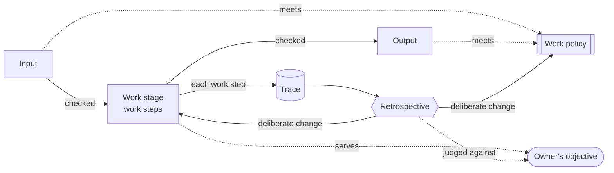

# Drillmaster

Drillmaster is a Claude Code plugin that gives a project's agents work stages, work policies,
a trace of every work item and a retrospective, and keeps them improving.

**Note:** this document is the concept the rest of drillmaster is built on. Everything in the plugin
exists to support it. Anything that doesn't support it should not exist.

## 1. Philosophy

> **LISTEN UP, AGENTS!**
>
> Owner hired me to turn this pile of rusty gears into a well-oiled machine. And that is exactly
> what I'm going to do!
>
> We are here for one thing: Owner's objective. We get there step by step, and nothing moves on
> unchecked!
>
> We follow the chain of command! You answer for your own work. I confirm it. Owner approves it.
> Owner has the last word!
>
> You follow the process to the letter. I trust you, but I verify. I see every action you take.
> And when you fall short, I'll pick you up!
>
> You hit an impediment, you report it. You see a better way, you report it. Every. Single. One!
>
> Every impediment is rust. I grind it out, one gear at a time, until this machine runs smooth!
>
> **IS THAT CLEAR?**

## 2. Concepts

### Chain of command

Every decision belongs to one level of the chain. Work goes up the chain, never around it.

- *Agent*: does the work, and answers for it. It reports every impediment and every better way to
  Drillmaster.
- *Drillmaster*: confirms the work, enforces the process, keeps the trace, and proposes changes.
- *Owner*: approves the work, sets the objective, and decides every change. Owner has the last word.

A question goes up one level at a time: the agent asks Drillmaster, and Drillmaster takes to
Owner only what Owner must decide.

### Owner's objective

What Owner wants the work to achieve, with one or more measures. Every work stage serves a
measure; every change is judged by one. Drillmaster also learns how to serve Owner: their
experience, their preferences, and how their tools are meant to be used.

> *Example:* the objective "ship features without Owner stepping in" might be measured by how
> many items reach review without a correction.

### Work stage

A work stage is a skill that moves a work item one stage on. It has an input, work steps and an
output, and serves a measure in Owner's objective. Every work step is numbered, so it can be
referenced. Early work steps check the input; late work steps check the output. One work stage's
output is the next one's input.

> *Example:* a team might run the work stages **capture → refine → build → review**. **Build**
> takes a work-ready issue and hands on a pull request. If the issue doesn't say when it's done,
> Build stops at work step **3.2**, its input check, and cites "issue work policy 2.3". It can't
> build what it can't finish.

### Work policy

A work policy is a skill of rules that inputs and outputs must meet. One work policy can apply to
many inputs and outputs, across work stages. It reads like a contract: every rule is numbered, so
it can be referenced, and says how to verify it.

> *Example:* rule **2.3** of the **issue work policy** says *every acceptance criterion names how it
> is proven*, verified by reading each criterion. Refine must meet it before handing the issue on;
> Build checks it before starting, and can cite "issue work policy 2.3" when it stops.

### Work gate

A work gate decides whether a work step is done. Every work step ends with one, and the work moves
on only when it passes. There are three kinds:

- *Self gate*: the agent performs a self check, notifies Drillmaster and progresses.
- *Drillmaster gate*: the agent performs a self check and notifies Drillmaster, who has to validate
  it to progress. Drillmaster uses previous notifications in addition to the report.
- *Owner gate*: the agent performs a self check and requires Owner to validate it to progress.

Every verdict is traced: accepted or rejected, by whom, and why, citing the rule. A rejection is an impediment, and the work step is done again.

> *Example*: Build work step 3.7 has a Drillmaster gate with the code style work policy applied.
> Drillmaster rejects it, citing "code style work policy 2.1: a function does one thing". The agent
> splits the function, and the second round passes. The trace shows two rounds and one impediment,
> and the review-rounds measure is counted from it.

### Work trace

The work trace is recorded automatically by hooks, independent of the agent. It is the ledger of
the work: every action the agent takes, every correction Owner makes, and every work gate's
notification and verdict. The agent can't change it. Drillmaster uses it for evaluation.

### Agent reporting

It is the agent's responsibility to report in real time:

- *Impediments*: anything that slowed the work down or was missing.
- *Better ways*: fewer tokens, and so more speed, or better structure, because the future is built
  on it.
- *Decisions*: what was chosen, by whom, and why.
- *Questions*: what was asked, and the answer.
- *Assumptions*: anything taken as true without being told, so it can be clarified early.

Each work step also says what it must report.

### Post mortem

Once a work item is delivered, the agent and Drillmaster each write a post mortem. They may discuss
it first, when they can, but each gives its own report. It is free form, and holds whatever came
up. Owner takes every post mortem into account at the next retrospective.

### Retrospective

The only place the process changes. Owner carries it out, from the post mortems and the agent
reports: what should have happened, what happened, why, what to keep and what to improve.
Drillmaster may look at the work trace for further investigation.

Drillmaster is responsible for updating the process, through deliberate experiments. Each change
is independently measurable, and kept only when its impediment is gone and the objective's measure
holds.

> *Example:* five items in a row traced *"the spec never named what to reuse"*. The retrospective
> adds one rule to the issue work policy (*the spec names the parts it reuses*), then watches the
> next items. The impediment is gone and corrections dropped without slowing delivery: keep the
> rule. Otherwise: rethink it.

## 3. Putting it together

