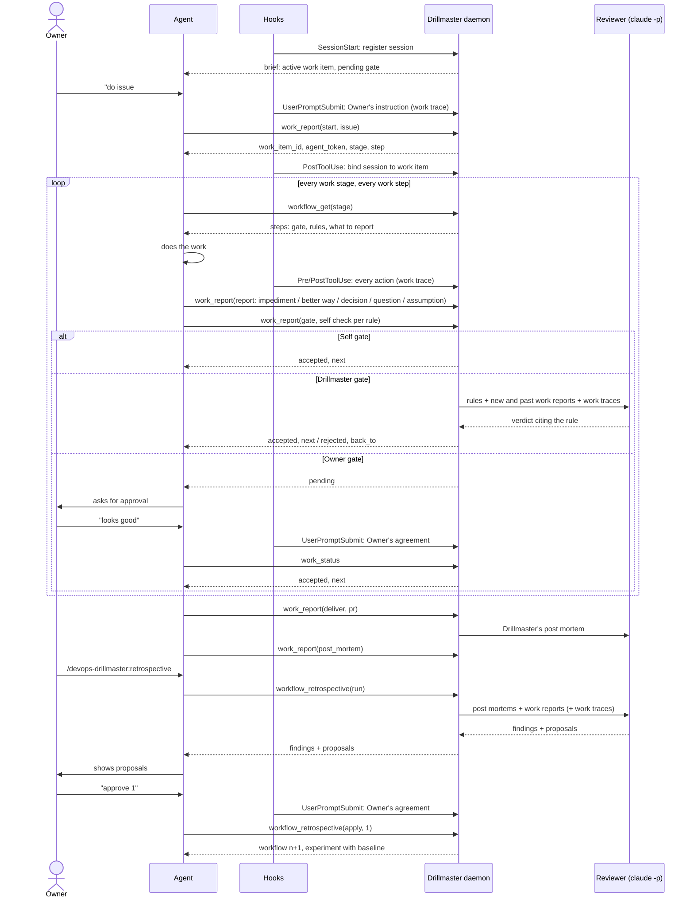

# Plan: build the Drillmaster plugin around the concept

## Context

The repo `C:\repo\claude-devops-drillmaster` only holds the concept skill
(`skills/concept/SKILL.md`), the plugin and marketplace manifests, the README and the license. To make
the concept real, it needs:

- a shared local server that collects the work traces and work reports;
- the gates that run through that server;
- hooks that record everything Agent does, out of Agent's reach;
- skills that teach Agent and Owner how to use it all.

Decisions so far:

- **Server:** one npm package that runs as a shared local daemon. A stdio MCP shim starts the daemon
  if it isn't running, and remote hosting later only changes the URL.
- **Drillmaster reviewer:** a headless `claude -p` run, so it needs no API key.
- **Owner gate:** for v1, any agreement Owner writes directly to Agent is enough. A hook captures it,
  so Agent can't forge it.
- **All storage goes through the server.**
  - Agent writes through the MCP tools, and the hooks write through the server's REST endpoint.
  - Nothing is written into the project, and there are no token files.
  - Traces are JSONL inside the server, and agents read them through tools.
- **Workflow:** one machine-only document per project, kept by the server. `workflow_0` holds only
  Owner's objective.
- **Session binding:** the session id is bound to the work item when it's created. Agent gets a
  token to submit with, and the hooks are identified by their session.
- **Concept skill:** no implementation details go into it. This plan lives outside the concept.

## Layout

```
claude-devops-drillmaster/
|-- .claude-plugin/plugin.json, marketplace.json   (existing)
|-- .mcp.json                     -> {"drillmaster": {"command": "npx", "args": ["-y", "claude-devops-drillmaster@<ver>", "mcp"]}}
|-- hooks/hooks.json              -> node "${CLAUDE_PLUGIN_ROOT}/scripts/hook.mjs" <event>
|-- scripts/hook.mjs              zero-dependency, fail-silent hook client (pattern from
|                                claude-coach/plugins/devops-drillmaster/scripts/hookInput.mjs runHook)
|-- skills/concept/               (existing, unchanged)
|-- skills/setup/ work/ retrospective/
|-- .github/workflows/ci.yml
`-- server/                       npm package "claude-devops-drillmaster", bin "drillmaster"
    |-- src/core/        pure domain: events, workflow, work item state, gates, measures (no I/O)
    |-- src/ports.ts     interfaces: EventStore, Reviewer, Clock, Ids
    |-- src/adapters/    jsonl-store, memory-store, claude-reviewer, scripted-reviewer, clocks
    |-- src/daemon/      HTTP API over core + adapters
    |-- src/mcp/         stdio shim
    |-- src/cli.ts       daemon | mcp | init | inspect
    `-- test/
        |-- unit/        core: given events -> expected state
        |-- api/         daemon HTTP contract, in-process
        |-- mcp/         stdio shim through the MCP SDK client
        |-- hooks/       hook.mjs fed with recorded hook payloads
        |-- plugin/      real Claude Code, headless, scripted prompts
        `-- sim/         scenarios, dummy projects, Owner simulator, runs/
```

## Built to be tested end to end

Every layer can be driven and checked without a human, from a pure function up to a full session
with a simulated Owner. These seams are part of the design, not added afterwards.

1. **Event-sourced core.**
   - The daemon stores only append-only events: work item started, work report, work trace, gate
     submitted, verdict, Owner input, delivered, post mortem, workflow changed.
   - Every state is a pure fold over the events: where a work item is, a pending gate, the current
     workflow, the measures.
   - Tests are "given these events, expect this state". Any run can be replayed exactly from its
     JSONL.
2. **Ports and adapters.** The core talks only to `EventStore`, `Reviewer`, `Clock` and `Ids`. In
   tests they become:
   - a memory store;
   - a **scripted reviewer**, which gives verdicts from a fixture, so Drillmaster gates and
     retrospectives are deterministic;
   - a fixed clock;
   - sequential ids.

   Production uses the JSONL store, `claude -p`, the system clock and random ids.
3. **Isolated environment.**
   - `DRILLMASTER_HOME` sets where the server keeps its port file and its store. It defaults to
     `~/.drillmaster`.
   - Every test and every simulation run gets its own temp home, daemon and port, so runs never
     touch each other or your real data.
   - `DRILLMASTER_REVIEWER=claude|scripted:<file>` picks the reviewer, and
     `DRILLMASTER_CLOCK=system|fixed:<iso>` picks the clock.
4. **Inspectable.** `drillmaster inspect --home <dir> [--work-item <id>] --json` dumps the events and
   the folded state, and the daemon's read-only `GET /state` does the same. Every test layer asserts
   on this one view.
5. **Record and replay.** With `DRILLMASTER_RECORD=1`, `hook.mjs` and the shim save the raw hook
   payloads and MCP calls they see. A live or simulated session can then be turned into regression
   fixtures: hook payloads for `test/hooks`, and event logs for `test/unit`.

## Server (`server/`)

- **`drillmaster daemon`: the Drillmaster server.** It is the only thing that stores anything.
  - Serves on 127.0.0.1, and writes `{port, pid}` to `$DRILLMASTER_HOME/daemon.json` so the clients
    can find it.
  - One server serves all projects and sessions.
  - **MCP API:** the four tools below, reached through the stdio shim.
  - **REST API:** used by the hooks and the CLI.

    | Endpoint | Purpose |
    |---|---|
    | `POST /hooks/:event` | Takes the raw hook payload (`session_id`, `cwd`, tool name, input and response summary, prompt) and stores it as a work trace. The response carries whatever the hook should output, such as the SessionStart brief. |
    | `POST /projects/init` | Creates `workflow_0` from Owner's objective. Used by `drillmaster init` and the `setup` skill. |
    | `GET /state` | Read only: the events and the folded state, for `inspect` and the tests. |
    | `GET /health` | Lets the shim and the hooks check the server is up. |

  - **Store:** one append-only `events.jsonl` per project, under
    `$DRILLMASTER_HOME/projects/<hash of project dir>/`. Work traces, work reports, gate verdicts,
    post mortems, session bindings and workflow changes are all event types, and nothing is ever
    rewritten.
  - **Workflow:** folded from the workflow events into one document, which `workflow_get` returns.
    Every version stays in the events, so the history comes for free.
- **`drillmaster mcp`**
  - A stdio MCP shim. It starts the server if `daemon.json` is missing or the port is dead.
  - It lists the tools, forwards each call, and passes its project dir along.
- **Tokens and session binding**
  - `work_report(action: "start")` returns `{work_item_id, agent_token}`, and every write tool needs
    that token.
  - The PostToolUse hook payload for that call carries the `session_id`, and the server binds that
    session to the work item.
  - From then on, the server accepts hook traces only for bound or registered sessions. The tokens
    live only in server memory and the event store.
  - v1 limitation: on one machine, Agent could still call the localhost REST endpoint itself, for
    example with curl. Running the server remote with a hook secret closes this gap.

### MCP tools (four, refined with Owner)

**`work_report`** is the only tool Agent writes with. The `action` field decides the schema, and every
call is one entry in the work item's stream of work reports. Stage and step are separate fields.

```
work_report({ action: "start", issue: "#12" })
-> { work_item_id, agent_token, stage, step }   // stage/step null under workflow_0

work_report({ token, action: "report", stage: 1, step: 2,
  kind: "impediment" | "better_way" | "decision" | "question" | "assumption" | "required",
  text })                       // decision: + { chosen, by, why }   question: + { asked, answer }

work_report({ token, action: "gate", stage: 1, step: 2,
  self_check: [{ rule: "pr 1.1", accepted, evidence }],   // one per referenced rule, else refused
  text })                                                // the step's required report
-> { verdict: accepted | rejected | pending, by, why, rule, back_to?, next: { stage, step } }

work_report({ token, action: "deliver", pr: "#40" })
work_report({ token, action: "post_mortem", keep, change, experiment_reflections, free_text })
```

- A **self gate** is accepted at once.
- A **Drillmaster gate** runs the reviewer.
- An **Owner gate** returns `pending`. It's accepted when the UserPromptSubmit hook captures Owner
  agreeing.
- `deliver` also starts Drillmaster's post mortem in the background.
- Every result returns the next position, so Agent always knows where it is.

**`workflow_get`** returns information about the workflow only. It takes no token, because the
workflow is the same for everyone in the project.

```
workflow_get({})             -> objective, measures, stage list, running experiments
workflow_get({ stage: 1 })   -> its steps: gate, rules in full, what to report
workflow_get({ full: true }) -> the whole workflow
```

**`work_status`** is the read tool for status and history. It replaces separate tools for traces,
reports and gate status.

```
work_status({ token })                    -> { stage, step, pending_gate? }
work_status({ token, last: 5 })           -> + the last 5 work reports
work_status({ token, stage: 1, step: 2 }) -> + the work reports and work traces captured in 1.2
```

**`workflow_retrospective`** is called by Owner and carried out by Drillmaster.

```
workflow_retrospective({ action: "run" })
-> { findings: { should, did, why, keep, improve },
    proposals: [{ id, change, purpose, measure, baseline }] }
workflow_retrospective({ action: "apply", proposal: 1 })
-> refused unless the hook captured Owner's agreement
-> { workflow: n+1 }   // archives workflow_n, opens the experiment with its baseline
```

### Sequence



### Reviewer (`src/reviewer/`)

- It spawns `claude -p --output-format json` with:
  - a Drillmaster system prompt, built from the concept skill;
  - the rules the gate references;
  - the new work report, the past work reports and the work traces.
- It expects JSON back: `{accepted, rule, why, back_to}`.
- The same runner writes Drillmaster's post mortem and the retrospective draft.
- It has a timeout. On failure, the gate stays pending, and the failure is recorded as an
  impediment.

### Measures (`src/measures/`)

v1 ships a fixed set, computed from the traces:

- Owner corrections per work item;
- gate rejections and review rounds per work item;
- time per work item;
- tool calls per work item.

The objective names measures from this set.

## Workflow document

The workflow is one machine-only document per project, kept inside the server and folded from its
workflow events. It holds the objective, the work stages and their work steps, the work policies,
and the running workflow experiments. Only the server writes it, and Agent and Owner read it through
`workflow_get`. It's stored as JSON. It's shown here in YAML only for readability:

```yaml
version: 2
objective:
  text: ship features without Owner stepping in
  measures: [owner_corrections_per_item]
stages:
  - n: 1
    name: build
    steps:
      - n: 1
        name: run the tests
        gate: self                 # self | drillmaster | owner
        rules: ["pr 1.1"]
        report: [test result]
policies:
  - name: pr
    rules:
      - id: "1.1"
        rule: the PR says what it changes
        verified_by: reading the PR description
experiments:
  - id: 1
    change: add pr 1.1
    purpose: "Owner corrected missing PR descriptions"
    measure: owner_corrections_per_item
    baseline: 2.0
    started: 2026-11-09
```

`workflow_0` is `version: 0`, holding the objective and empty lists. Earlier versions are read back
from the events, for example with `workflow_get({ version: 0 })`.

## Hooks (`hooks/hooks.json`, all via `scripts/hook.mjs`, fail-silent, short timeouts)

`hook.mjs` stores nothing itself. It forwards the raw hook payload to `POST /hooks/:event`, and
prints whatever the server returns.

| Event | Records |
|---|---|
| SessionStart | Registers the session. Injects a brief with the active work item and step, any pending gates, and a pointer to the `concept` skill. |
| UserPromptSubmit | Owner's instruction or correction, as a trace. If an Owner gate is pending, the daemon has the reviewer classify the prompt as agreement or not, and records Owner's verdict. Owner's approval of a pending workflow change is captured the same way. |
| PreToolUse / PostToolUse (matcher `*`) | Every action Agent takes: tool, input summary, result status. The PostToolUse hook on `work_report(start)` also does the session binding. |
| Stop, SubagentStop | The end of a turn, so time and turn counts are measurable. |

The hooks only record in v1. Blocking progress on an unpassed gate can come later, as a workflow
experiment.

## Skills (no implementation details leak into `concept`)

- **`setup`**: Owner states the objective and picks its measures from the v1 set. The skill runs
  `npx claude-devops-drillmaster init`, which sends the objective to the server's `POST /projects/init` to create `workflow_0`.
- **`work`**: how Agent runs a work item with the tools:
  - start the item;
  - follow `workflow_get`;
  - report in real time;
  - submit each gate;
  - deliver;
  - write the post mortem.
- **`retrospective`**: Owner calls it. The skill runs `workflow_retrospective(run)`, shows the proposals, and
  applies each one Owner agrees to.
- **Generated stage skills (later):**
  - `drillmaster generate` writes `.claude/skills/drillmaster-<stage>/SKILL.md` from the workflow file.
  - It runs after every applied workflow change.
  - It's not needed for `workflow_0`.

## Build order

Each phase is one PR. It ships its own tests in every layer it touches, and CI is green before the
next phase starts.

1. **Test bed first.**
   - The `server/` package, with `core/` and the ports, the memory store, the scripted reviewer, the
     fixed clock, `DRILLMASTER_HOME` and `inspect`.
   - vitest, plus `ci.yml` running the unit, api, mcp and hooks layers on Windows and Ubuntu.
   - The daemon with its port file, the stdio shim with auto-start, `workflow_get`, `init`
     (`workflow_0`), and `.mcp.json`.
2. **Traces.**
   - `hook.mjs` and `hooks.json`, session registration, `work_report(start)` with tokens and
     binding, the PreToolUse/PostToolUse/UserPromptSubmit traces, and `work_status`.
   - Record mode. Then capture real hook payloads once from a live session, as fixtures.
3. **Work execution.** `work_report` report/gate/deliver actions, self gates, `workflow_get`, the stage and step
   progression, and the `work` skill.
4. **Drillmaster and Owner gates.** The `claude -p` reviewer behind the Reviewer port, with the
   scripted reviewer in tests, and the Owner gate through the UserPromptSubmit hook.
5. **Improvement.** Delivery, both post mortems, the measures, `workflow_retrospective`
   run/apply with history and experiments, and the `setup` and `retrospective` skills.
6. **Plugin and simulation layers.** The `test/plugin` layer, and the `test/sim` harness with a
   scripted Owner and an LLM Owner. Write 2-3 scenarios, run them, fix what they expose, and repeat
   until they pass.
7. **Publish.** Publish to npm, pin the version in `.mcp.json`, and update the README. The stage-skill
   generator comes after this.

## Verification: the test layers

| Layer | Drives | Real parts | Faked | Runs |
|---|---|---|---|---|
| unit | the core functions | the core | everything else | CI |
| api | the server's REST endpoints, in-process: `/hooks`, `/projects/init`, `/state` | core, server, store | reviewer, clock | CI |
| mcp | the stdio shim, as a spawned process via the MCP SDK client | shim, daemon, store | reviewer, clock | CI |
| hooks | `hook.mjs` with the recorded payloads on stdin | hook client, daemon, store | Claude Code | CI |
| plugin | `claude -p --plugin-dir <repo>` in a temp project, with scripted prompts | Claude Code, plugin, hooks, MCP, daemon | reviewer, Owner (scripted) | local, nightly |
| sim | an Agent SDK session and an Owner simulator, multi-turn | everything | nothing in LLM mode | on demand |

Every layer asserts through `inspect` or `GET /state`. The unit layer covers:

- validation of the workflow file;
- append-only events;
- token and session matching;
- gate state transitions;
- measures from fixture events.

**Simulated Owner (`test/sim/`)**, the main end-to-end test:

- **A scenario** is one file, holding:
  - the dummy project template;
  - the objective and measures;
  - the issues to hand out;
  - the hidden rules Owner cares about but never states up front;
  - when to call a workflow retrospective;
  - which proposals to agree to;
  - the run's assertions.
- **Agent** is a Claude Agent SDK session. It loads the plugin from the repo (`--plugin-dir`), runs
  in a fresh git copy of the project, and gets its own `DRILLMASTER_HOME`.
- **Owner** comes in two modes:
  - **Scripted:** fixed lines per turn. It's deterministic enough to catch regressions.
  - **LLM:** a second Claude session with the Owner persona and the scenario. It's exploratory.
- **Agent to agent:** the harness relays messages. Owner's every message goes into the Agent
    session as a real user turn, so the UserPromptSubmit hook captures it exactly as it would a
    human's. Agent's replies go back to Owner. A run ends when the scenario's issues are delivered,
    or at a turn or cost cap.
- **Assertions run on `inspect`:**
  - Owner's corrections are recorded as work traces;
  - every tool call is traced;
  - every gate verdict cites a rule;
  - both post mortems exist;
  - the workflow grew from version 0, and experiments were opened with baselines;
  - tokens and sessions match;
  - Owner corrections per work item trend down.
- **Repeats:** LLM runs are not deterministic, so each scenario runs N times and reports pass rates.
  Each run's transcript, events, workflow file and result are kept under
  `test/sim/runs/<timestamp>/`, and failing runs become replay fixtures.
- **End to end, by hand:** a final check with a real Owner (you), running
  `claude --plugin-dir C:\repo\claude-devops-drillmaster` in a scratch project.
  1. Run `/devops-drillmaster:setup`, then do one work item on `workflow_0`.
  2. Correct Agent once, and check with `drillmaster inspect` that the tool calls and the correction are recorded.
  3. Run `/devops-drillmaster:retrospective`. Agree to a change, and check that `workflow_1` is
     archived and the experiment is opened with its baseline.
  4. Add a Drillmaster gate, and check that `claude -p` returns a verdict citing the rule.
- `claude plugin validate .` and `--profile directory` pass after each phase.
