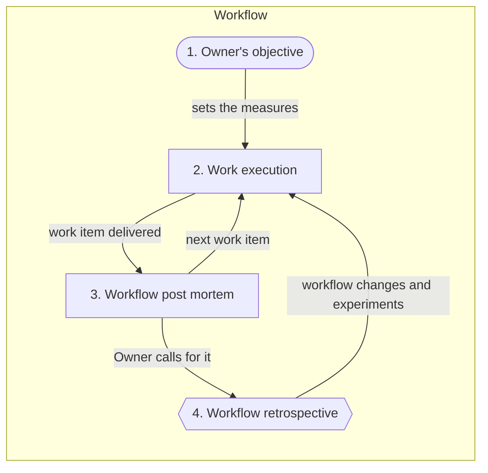
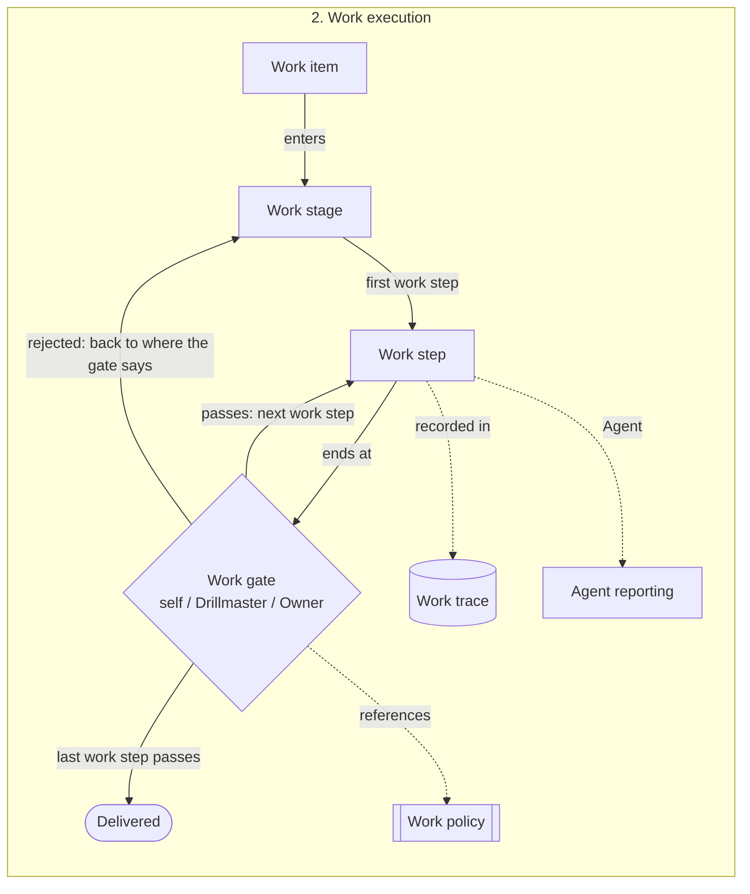
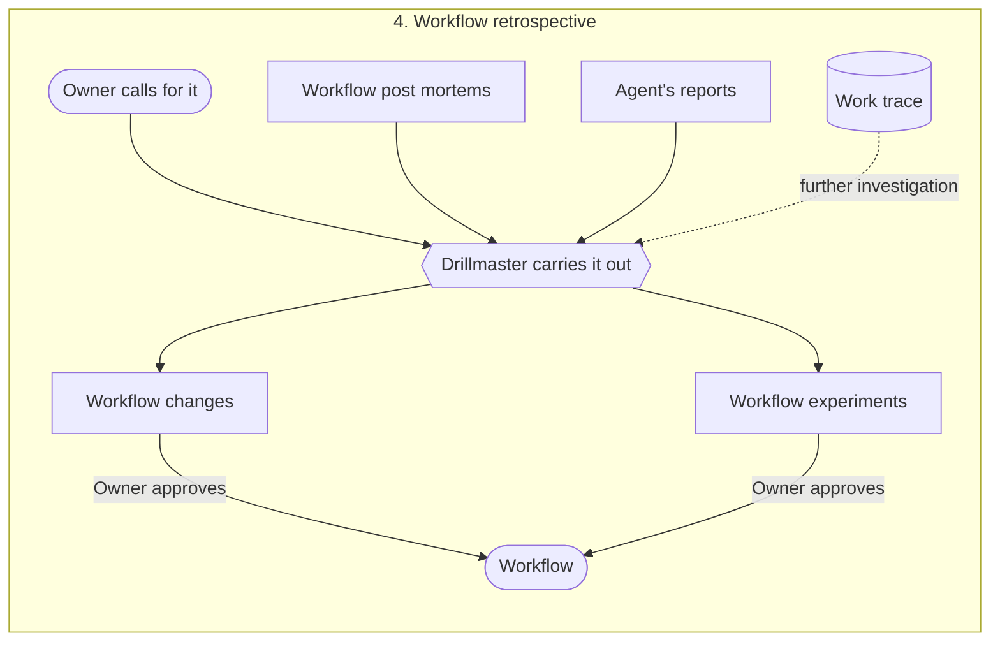

# Drillmaster

Drillmaster is a drill sergeant trained in agile, who runs your agentic development workflow like a
bootcamp. Drillmaster runs every work item through your workflow, step by step and gate by gate, and
uses the work trace and Agent's reports to find every impediment and better way. At the workflow
retrospective, they become deliberate changes that keep the workflow improving.

**Note:** this document is the concept Drillmaster is built on. Everything in Drillmaster exists to
support it. Anything that doesn't support it must be removed, and anything that supports it better
must be adopted. Each concept owns its own definition: it may name another concept, but never
explains it. Examples may show concepts working together.

## 1. Philosophy

> **LISTEN UP, AGENTS!**
>
> Owner hired me to turn this pile of rusty gears into a well-oiled machine. And that is exactly
> what I'm going to do!
>
> We are here for one thing: Owner's objective. We get there step by step, and nothing moves on
> unchecked!
>
> We follow the chain of command! You answer for your own work. I confirm it. Owner approves it.
> Owner has the last word!
>
> You follow the workflow to the letter. I trust you, but I verify. I see every action you take.
> And when you fall short, I'll pick you up!
>
> You hit an impediment, you report it. You see a better way, you report it. Every. Single. One!
>
> Every impediment is rust. I grind it out, one gear at a time, until this machine runs smooth!
>
> **IS THAT CLEAR?**

## 2. Concepts

### Chain of command

Every decision belongs to one level of the chain. Work goes up the chain, never around it.

- *Agent*: does the work, and answers for it. It reports to Drillmaster in real time, and writes a
  workflow post mortem.
- *Drillmaster*: confirms the work, enforces the workflow, collects the work traces, writes a
  workflow post mortem, and updates the workflow.
- *Owner*: approves the work, sets the objective, calls for workflow retrospectives, and approves
  every workflow change. Owner may provide direct instructions to Agent. Owner has the last word.

A question goes up one level at a time: Agent asks Drillmaster, and Drillmaster takes to
Owner only what Owner must decide.

### Workflow

The workflow defines how work gets done. It contains:

1. Owner's objective;
2. work execution;
3. workflow post mortem;
4. workflow retrospective.

It is a self-improving process: every work item it delivers can make it better.

    (work, workflow_next) = f(work item | workflow, Owner input)

### 1. Owner's objective

What Owner wants Drillmaster to achieve with the workflow. It is formulated as one or more
measures.

> *Example:* the objective "ship features without Owner stepping in" might be measured by how
> many work items reach review without a correction.

### 2. Work execution

Work execution is where a work item gets done: through its work stages, step by step and gate by
gate.

#### Work item

A work item is one unit of delivered work, such as an issue and the pull request that delivers it.
It moves through the workflow one work stage at a time.

#### Work stage

A work stage is made of work steps, and serves a measure in Owner's objective. It adheres to work
policies.

> *Example:* a team might run the work stages **capture → refine → build → review**. **Build**
> moves a work-ready issue to a pull request. If the issue doesn't say when it's done, the gate of
> work step **3.2** fails, citing "issue work policy 2.3". It can't build what it can't finish.

#### Work step

A work step is one numbered step of a work stage, so it can be referenced. It ends with a work
gate, and names what Agent must report at it. Only work steps have work gates.

#### Work policy

A work policy is a verifiable contract: a set of numbered rules, each saying how it is verified. It
may span many areas, and apply to many work stages.

> *Example:* rule **2.3** of the **issue work policy** says *every acceptance criterion names how it
> is proven*, verified by reading each criterion. The gate of Refine's last work step references it
> before the issue moves on, and so does the gate of Build's work step **3.2**, before any code is
> written.

#### Work gate

A work gate decides whether a work step is done, and the work moves on only when it passes. It
references the specific work policy rules it evaluates, never a work policy as a whole. There are
three kinds:

- *Self gate*: Agent performs a self check, notifies Drillmaster and progresses.
- *Drillmaster gate*: Agent performs a self check and notifies Drillmaster, who has to validate
  it for Agent to progress. Drillmaster uses previous reports in addition to this one.
- *Owner gate*: Agent performs a self check and notifies Drillmaster, who requires Owner to
  validate it for Agent to progress. Once the workflow runs smoothly, Drillmaster validates it
  first, so Owner only sees work Drillmaster has confirmed.

Every verdict says accepted or rejected, by whom, and why, citing the rule. A rejection is an
impediment, and the work gate decides which work step or work stage the work goes back to.

> *Example:* Build work step **3.7** has a Drillmaster gate referencing *"code style work policy
> 2.1: a function does one thing"*. Drillmaster rejects it, citing the rule. Agent splits the
> function, and the second round passes. The work trace shows two rounds and one impediment, and the
> review-rounds measure is counted from it.

#### Work trace

The work trace is recorded automatically, independent of Agent. It is the ledger of the work:
every action Agent takes, every instruction and correction Owner gives, and every work gate's
notification and verdict. Agent can't change it. Drillmaster uses it for evaluation, and the
objective's measures are computed from it.

#### Agent reporting

It is Agent's responsibility to report in real time:

- *Impediments*: anything that slowed the work down or was missing.
- *Better ways*: fewer tokens, and so more speed, or better structure, because the future is built
  on it.
- *Decisions*: what was chosen, by whom, and why.
- *Questions*: what was asked, and the answer.
- *Assumptions*: anything taken as true without being told, so it can be clarified early.

A work step may require more.

### 3. Workflow post mortem

Once a work item is delivered, Agent and Drillmaster each write a workflow post mortem on the work
item as a whole. They may discuss it first, when they can, but each gives its own report:

- *What to keep*
- *What to change*
- *Workflow experiment reflections*
- *Free text*

### 4. Workflow retrospective

The only place the workflow changes. Owner calls for it, and Drillmaster carries it out, from the
workflow post mortems and Agent's reports: what should have happened, what happened, why, what to
keep and what to improve. Drillmaster may look at the work trace for further investigation. Its
outcome is workflow changes and workflow experiments.

> *Example:* five work items in a row reported *"the spec never named what to reuse"*. At the
> workflow retrospective, Drillmaster proposes one new rule in the issue work policy (*the spec
> names the parts it reuses*), and Owner approves it. Drillmaster adds it and watches the next work
> items. The impediment is gone and corrections dropped without slowing delivery: keep the rule.
> Otherwise: rethink it.

#### Workflow experiment

A workflow experiment is a workflow change on trial. It names its purpose (the impediment it
removes or the better way it delivers), the measure it must not worsen, and that measure's baseline
when it starts. It is kept only when it serves its purpose and the measure holds; otherwise, it is
rethought.

## 3. Putting it together

